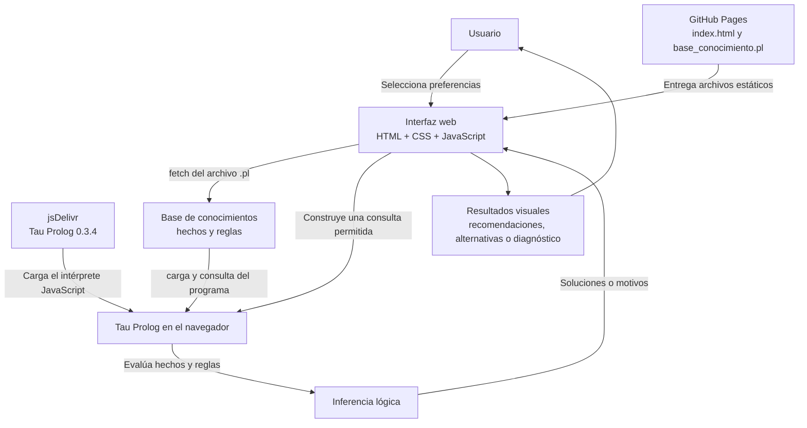

# DOCUMENTO TÉCNICO

## GameFinder: Sistema experto recomendador de videojuegos

**Institución:** Instituto Politécnico Nacional — Escuela Superior de Cómputo  
**Unidad de aprendizaje:** Paradigmas de Programación  
**Profesor:** Ursula Samantha Morales Rodriguez  
**Grupo:** 3CV3  
**Integrante:** Garcia Fernandez David  
**Fecha:** 18 de octubre de 2026  

**Repositorio:** [DaichiMercer/Proyecto_Prolog](https://github.com/DaichiMercer/Proyecto_Prolog)  
**Aplicación publicada:** [GameFinder en GitHub Pages](https://daichimercer.github.io/Proyecto_Prolog/)

---

## Índice

1. [Portada: datos del equipo y del proyecto](#1-portada-datos-del-equipo-y-del-proyecto)
2. [Introducción](#2-introducción)
3. [Planteamiento del problema](#3-planteamiento-del-problema)
4. [Objetivos](#4-objetivos)
5. [Justificación del uso de Prolog](#5-justificación-del-uso-de-prolog)
6. [Descripción de la base de conocimientos](#6-descripción-de-la-base-de-conocimientos)
7. [Hechos y reglas principales](#7-hechos-y-reglas-principales)
8. [Diagrama de arquitectura](#8-diagrama-de-arquitectura)
9. [Funcionamiento de la interfaz](#9-descripción-del-funcionamiento-de-la-interfaz)
10. [Tecnologías utilizadas](#10-tecnologías-utilizadas)
11. [Integración y despliegue](#11-procedimiento-de-integración-y-despliegue)
12. [Pruebas y resultados](#12-pruebas-y-resultados)
13. [Problemas encontrados y soluciones implementadas](#13-problemas-encontrados-y-soluciones-implementadas)
14. [Conclusiones individuales](#14-conclusiones-individuales)

---

## 1. Portada: datos del equipo y del proyecto

| Dato | Información |
|---|---|
| Proyecto | GameFinder: Sistema experto recomendador de videojuegos |
| Institución | Instituto Politécnico Nacional — Escuela Superior de Cómputo |
| Materia | Paradigmas de Programación |
| Profesor | Ursula Samantha Morales Rodriguez |
| Grupo | 3CV3 |
| Integrante | Garcia Fernandez David |
| Fecha | 18 de octubre de 2026 |
| Repositorio | https://github.com/DaichiMercer/Proyecto_Prolog |
| Aplicación | https://daichimercer.github.io/Proyecto_Prolog/ |

## 2. Introducción

GameFinder es una aplicación web académica que recomienda videojuegos a partir de las preferencias y restricciones que selecciona el usuario. El sistema considera datos como la plataforma disponible, el presupuesto, el modo de juego, el tiempo por sesión, la conexión a internet, los géneros preferidos y la dificultad deseada.

La parte de razonamiento se representa mediante hechos y reglas Prolog en el archivo `docs/base_conocimiento.pl`. La interfaz, desarrollada con HTML, CSS y JavaScript, permite elegir opciones sin tener que escribir consultas manualmente. En la versión publicada, el intérprete Tau Prolog se ejecuta directamente en el navegador y evalúa el archivo de conocimiento.

Además de devolver recomendaciones, la aplicación permite buscar alternativas que cumplen las restricciones principales aunque no coincidan con todas las preferencias, así como solicitar una explicación de los motivos por los que un juego no cumple ciertos criterios. Los precios y las categorías utilizados son valores de referencia estáticos del proyecto; no corresponden a una consulta de precios en tiempo real.

## 3. Planteamiento del problema

La selección de un videojuego puede depender de varios factores al mismo tiempo. Una persona puede disponer de una plataforma específica, tener un presupuesto limitado, jugar sin conexión a internet o preferir determinadas modalidades, duraciones de sesión, géneros y niveles de dificultad. Revisar manualmente cada juego y comparar todas esas características puede resultar tedioso.

El problema que aborda GameFinder consiste en evaluar un catálogo de videojuegos frente a un conjunto de condiciones y presentar los que son compatibles. Cuando no existe una coincidencia exacta, el sistema también puede buscar opciones alternativas o indicar por qué un videojuego seleccionado incumple una o más restricciones que el modelo puede revisar.

### Alcance del problema

- El catálogo actual contiene **19 videojuegos**.
- La información se encuentra almacenada en una base de conocimientos local al proyecto.
- Los precios están expresados en pesos mexicanos y son valores de referencia definidos para la práctica.
- La duración de sesión y la dificultad son categorías orientativas del modelo, no mediciones oficiales.
- La aplicación no consulta tiendas, precios actualizados, disponibilidad comercial ni información externa de los juegos durante una consulta.

Por tanto, GameFinder es un sistema de recomendación basado en reglas para un catálogo delimitado. No pretende sustituir una base de datos comercial ni ofrecer información en tiempo real.

## 4. Objetivos

### 4.1 Objetivo general

Diseñar e implementar una aplicación web que utilice una base de conocimientos Prolog para recomendar videojuegos de acuerdo con las preferencias y restricciones del usuario, permitiendo consultar coincidencias, alternativas y motivos de descarte mediante una interfaz accesible desde un navegador.

### 4.2 Objetivos específicos

1. Representar las características de un conjunto de videojuegos mediante hechos Prolog.
2. Construir reglas que relacionen plataforma, precio, modo de juego, duración de sesión, conexión, género y dificultad.
3. Obtener recomendaciones que cumplan las restricciones principales y las preferencias seleccionadas.
4. Permitir la búsqueda de alternativas cuando no se cumplen todas las preferencias.
5. Explicar las incompatibilidades que el sistema tenga definidas para un videojuego.
6. Crear una interfaz con listas desplegables que genere consultas sin exigir al usuario conocer la sintaxis de Prolog.
7. Publicar la aplicación y su código fuente para que puedan consultarse desde un navegador.
8. Documentar las limitaciones actuales y distinguir los datos de referencia de información comercial en tiempo real.

## 5. Justificación del uso de Prolog

Prolog es adecuado para este proyecto porque permite representar conocimiento mediante hechos y definir reglas que derivan conclusiones a partir de ellos. En GameFinder, cada videojuego se describe mediante propiedades, y los predicados de inferencia combinan esas propiedades con las opciones seleccionadas por el usuario.

El motor puede evaluar varias condiciones en una misma consulta, utilizar variables para encontrar los juegos que cumplen dichas condiciones y devolver distintas soluciones conforme busca coincidencias en la base de conocimientos. Esto resulta apropiado para un recomendador donde la respuesta no está limitada a un único resultado predefinido.

La lógica central se encuentra expresada en Prolog, mientras que JavaScript se utiliza para leer las opciones, formar consultas permitidas, ejecutar el intérprete y mostrar los resultados. De esta forma, la interfaz funciona como medio de interacción, y la evaluación de compatibilidad depende de los hechos y reglas consultados por el motor Prolog.

### Consideración sobre el intérprete empleado

La versión publicada usa **Tau Prolog 0.3.4**, un intérprete de Prolog que se ejecuta en el navegador. Esta decisión permite desplegar la aplicación como un sitio estático en GitHub Pages sin mantener un proceso de servidor Prolog independiente.

## 6. Descripción de la base de conocimientos

La base de conocimientos publicada se encuentra en `docs/base_conocimiento.pl` dentro del repositorio. Contiene hechos que describen los videojuegos y reglas que evalúan las condiciones de recomendación.

### 6.1 Predicados de datos

| Predicado | Función |
|---|---|
| `juego/2` | Relaciona el identificador lógico del juego con el nombre que se muestra al usuario. |
| `plataforma/2` | Indica en qué plataformas está registrado el juego. |
| `precio/2` | Almacena el precio de referencia del videojuego en MXN; `0` representa un juego gratuito en el modelo. |
| `genero/2` | Registra uno o varios géneros para cada juego. |
| `modo_juego/2` | Indica los modos de juego que están registrados. |
| `conexion/2` | Describe si el juego funciona sin conexión, admite conexión opcional o requiere conexión en línea. |
| `duracion_sesion/2` | Asigna una categoría orientativa de duración a las sesiones del juego. |
| `dificultad/2` | Asigna una categoría de dificultad. |
| `caracteristica/2` | Registra características adicionales, por ejemplo exploración, cooperación, historia o rejugabilidad. |

### 6.2 Catálogo registrado

Los 19 videojuegos incluidos en la versión consultada son:

1. Stardew Valley
2. Hollow Knight
3. Celeste
4. Terraria
5. Slay the Spire
6. Portal 2
7. Overcooked! 2
8. It Takes Two
9. Among Us
10. Rocket League
11. Fall Guys
12. A Short Hike
13. GRIS
14. Cuphead
15. Vampire Survivors
16. Balatro
17. Hades
18. Minecraft
19. Brawlhalla

### 6.3 Valores manejados por la interfaz

- **Plataforma:** PC, PlayStation, Xbox, Nintendo Switch y móvil.
- **Presupuesto:** cantidades de referencia entre $0 y $1,000 MXN.
- **Modo de juego:** cualquiera, individual, cooperativo local, cooperativo en línea y competitivo en línea.
- **Tiempo por sesión:** corto, medio o largo.
- **Conexión del usuario:** sin internet, con internet o cualquiera.
- **Dificultad:** cualquiera, fácil, media o alta.
- **Géneros:** se pueden elegir hasta dos; la lógica permite que el juego coincida con al menos uno de los géneros seleccionados.

Los términos internos usan átomos Prolog sin espacios ni acentos, como `cooperativo_local`, `sin_internet` o `aventura`. La interfaz presenta etiquetas legibles y envía a Prolog los valores internos correspondientes.

### 6.4 Crecimiento de la base

Agregar juegos implica registrar sus datos en los predicados correspondientes. La base de conocimiento crecerá conforme se agreguen videojuegos y características, pero las reglas generales pueden reutilizarse: normalmente no es necesario crear una regla nueva por cada juego. La principal tarea de mantenimiento consiste en incorporar datos coherentes y revisar que las categorías usadas coincidan con las que esperan las reglas.

## 7. Hechos y reglas principales

### 7.1 Hechos

Los hechos son afirmaciones registradas en la base de conocimientos. Por ejemplo, `juego/2` permite identificar el juego, y `precio/2` registra su costo de referencia. De forma conceptual, un videojuego puede tener varios hechos de plataforma, género o característica; la relación no exige limitarlo a una sola propiedad de cada tipo.

Ejemplos de datos existentes en el catálogo:

```prolog
juego(celeste, 'Celeste').
precio(celeste, 100).
genero(celeste, plataformas).
genero(celeste, aventura).
```

Estos hechos indican el identificador del juego, el nombre de presentación, un precio de referencia y dos géneros registrados. El motor utiliza esos datos al evaluar una consulta.

### 7.2 Reglas de compatibilidad

| Regla o predicado | Funcionamiento |
|---|---|
| `plataforma_compatible/2` | Comprueba que la plataforma solicitada esté registrada para el juego. |
| `dentro_presupuesto/2` | Obtiene el precio registrado y comprueba que no supere el presupuesto seleccionado. |
| `modo_compatible/2` | Comprueba el modo solicitado. La opción `cualquiera` permite cualquier juego registrado. |
| `tiempo_compatible/2` | Compara la duración del juego con el tiempo disponible. En la implementación actual, una sesión corta acepta juegos cortos, una media acepta juegos cortos o medios, y una larga permite cualquier categoría registrada. Por eso funciona como límite de tiempo disponible, no como exigencia de igualdad exacta. |
| `conexion_compatible/2` | Evalúa la disponibilidad de conexión. Sin internet acepta juegos `offline` y `online_opcional`; con internet admite las categorías registradas; `cualquiera` no filtra por conexión. |
| `genero_coincide/2` | Si no se selecciona ningún género, no filtra por género. Si se seleccionan géneros, busca una coincidencia con al menos uno de ellos. |
| `dificultad_coincide/2` | Permite cualquier dificultad cuando se elige `cualquiera`, o exige la categoría seleccionada. |
| `juego_viable/6` | Combina las restricciones obligatorias: plataforma, presupuesto, modo, tiempo y conexión. |

La regla `dentro_presupuesto/2` utiliza una comparación numérica. El uso de variables permite aplicar la misma regla a todos los juegos sin escribir una condición específica para cada uno.

### 7.3 Predicados de consulta

#### `recomendar/10`

Busca los videojuegos que cumplen las restricciones definidas por `juego_viable/6`, coinciden con los géneros solicitados y satisfacen la dificultad seleccionada. También devuelve el nombre y un nivel de coincidencia calculado por `nivel_coincidencia/4`.

La clasificación de coincidencia depende de las preferencias seleccionadas: el programa etiqueta el resultado como alto, medio o general según si se especificaron género y dificultad. No es una puntuación estadística; es una categoría derivada de las condiciones del modelo.

#### `alternativa/10`

Busca juegos que cumplen las restricciones de viabilidad, pero que no satisfacen al mismo tiempo la combinación de género y dificultad solicitada. Se apoya en la negación como fallo (`\+`) para encontrar opciones que no cumplen ese conjunto de preferencias. Su finalidad es proponer alternativas en lugar de devolver únicamente una lista vacía.

#### `motivo_descarte/7`

Devuelve los motivos de incompatibilidad implementados en el sistema. Puede identificar:

- `plataforma_incompatible`: el juego no tiene registrada la plataforma seleccionada.
- `supera_presupuesto`: el precio registrado es mayor que el presupuesto máximo.
- `modo_no_disponible`: el juego no cumple el modo solicitado.
- `tiempo_no_compatible`: la duración registrada no cumple la categoría seleccionada.
- `conexion_no_compatible`: la conexión disponible no es compatible con el juego.

Una consulta puede producir más de un motivo para el mismo juego. Este predicado no evalúa género ni dificultad; el diagnóstico se limita a las incompatibilidades que están codificadas en sus cláusulas.

### 7.4 Predicados auxiliares

La base también incluye `juegos_por_genero/3`, `juegos_por_plataforma/3` y `caracteristicas_juego/2`, destinados a consultar juegos por género, plataforma o característica registrada.

## 8. Diagrama de arquitectura

La aplicación desplegada es una arquitectura web estática. No utiliza un backend HTTP propio: el navegador descarga el intérprete Tau Prolog desde jsDelivr y carga el archivo Prolog publicado junto con la interfaz. La inferencia se ejecuta en el contexto del navegador.



### Flujo de una consulta

1. El usuario elige sus preferencias en las listas desplegables.
2. JavaScript obtiene los valores de los campos y forma una consulta a uno de los predicados permitidos.
3. La página crea una sesión de Tau Prolog, consulta la base de conocimientos y ejecuta la consulta.
4. Prolog devuelve una o varias soluciones, o indica que no existen coincidencias.
5. JavaScript interpreta las respuestas y las representa mediante tarjetas, mensajes o motivos de descarte.

Este flujo utiliza el motor Prolog para evaluar la base de conocimientos; no reemplaza las reglas por condicionales JavaScript equivalentes.

## 9. Descripción del funcionamiento de la interfaz

La interfaz está organizada en una sección de preferencias y otra para los resultados. Su diseño pretende que el usuario pueda formular consultas sin tener conocimientos previos de la sintaxis de Prolog.

### 9.1 Entradas

- Selección de plataforma.
- Selección del presupuesto máximo.
- Selección del modo de juego.
- Selección de la duración máxima disponible por sesión.
- Selección de disponibilidad de internet.
- Selección de dificultad deseada.
- Selección de hasta dos géneros preferidos.
- Selección del tipo de consulta.
- Selección del videojuego a analizar cuando se elige el diagnóstico de descarte.

### 9.2 Tipos de consulta

**Recomendar juegos que coincidan.** Genera una consulta a `recomendar/10`. Los resultados se presentan con el nombre, el precio registrado y la categoría de coincidencia calculada por las reglas.

**Buscar alternativas viables.** Genera una consulta a `alternativa/10`. Presenta juegos que cumplen las restricciones principales aunque no coincidan con todas las preferencias de género y dificultad.

**Explicar por qué se descarta un juego.** Genera una consulta a `motivo_descarte/7` para el juego seleccionado. Si se detectan motivos, la interfaz los explica en lenguaje natural. Si no se devuelve ninguno, indica que no se encontraron motivos dentro de las condiciones que evalúa ese predicado; esto no significa que se hayan comprobado todos los aspectos posibles del juego.

### 9.3 Visualización y manejo de errores

La página muestra el estado de carga del intérprete y de la base de conocimientos, presenta los resultados de cada consulta y permite ver la consulta Prolog generada. También incluye mensajes para consultas sin coincidencias y para errores al cargar el intérprete o leer el archivo `.pl`.

El botón de restablecimiento permite limpiar las selecciones y preparar una nueva consulta. Es posible ejecutar más de una consulta sin recargar manualmente la página.

## 10. Tecnologías utilizadas

| Tecnología | Uso dentro de GameFinder |
|---|---|
| HTML5 | Estructura y campos de la interfaz. |
| CSS3 | Estilos, distribución visual, tarjetas de resultados y adaptación a distintos tamaños de pantalla. |
| JavaScript | Lectura de selecciones, construcción de consultas, comunicación con el intérprete y presentación de resultados. |
| Tau Prolog 0.3.4 | Interpreta y ejecuta el programa Prolog dentro del navegador. Se carga desde jsDelivr. |
| Prolog (`.pl`) | Representación de hechos, reglas y predicados de consulta del sistema experto. |
| Git | Control de versiones del código. |
| GitHub | Alojamiento del repositorio y seguimiento de los cambios. |
| GitHub Pages | Publicación de la versión estática de la aplicación. |
| Visual Studio Code y Live Server | Herramientas de edición y pruebas locales, de acuerdo con el procedimiento de desarrollo. |

### Declaración importante sobre la tecnología Prolog


### Uso de herramientas de inteligencia artificial

Se utilizaron herramientas de inteligencia artificial como apoyo durante el desarrollo de la interfaz, la documentación y la resolución de dificultades de despliegue. También existió apoyo conversacional durante el trabajo con el código Prolog, por lo que la declaración final de uso de IA debe reflejar con exactitud esa participación y las reglas de la asignatura. La guía de la práctica limita la generación mediante IA de hechos, reglas y predicados Prolog; por ello, antes de entregar, el responsable debe asegurarse de poder explicar, verificar y modificar autónomamente la lógica y cumplir las condiciones académicas aplicables.

## 11. Procedimiento de integración y despliegue

### 11.1 Estructura publicada

La versión actual del sitio se organiza en la carpeta `docs/` del repositorio. Los archivos clave son:

```text
Proyecto_Prolog/
├── README.md
└── docs/
    ├── index.html
    └── base_conocimiento.pl
```

La constante de la interfaz que identifica la base de conocimientos debe coincidir con el nombre y la ubicación reales del archivo `.pl`. En la versión publicada, la página carga `base_conocimiento.pl` desde el mismo directorio que `index.html`.

### 11.2 Ejecución local

1. Clonar o descargar el repositorio.
2. Abrir el proyecto en Visual Studio Code.
3. Confirmar que `index.html` y `base_conocimiento.pl` se encuentren en el mismo directorio de publicación.
4. Ejecutar la interfaz mediante un servidor local, por ejemplo Live Server, en lugar de abrir el HTML directamente mediante una dirección `file://`.
5. Mantener una conexión a internet para que el navegador pueda descargar Tau Prolog desde jsDelivr.
6. Confirmar que se muestre el estado de base de conocimientos cargada y realizar las consultas desde la interfaz.

El servidor local es importante porque la página utiliza `fetch()` para recuperar el archivo `.pl`; los navegadores restringen la lectura de archivos locales bajo el esquema `file://`.

### 11.3 Publicación en GitHub Pages

1. Mantener `index.html` y `base_conocimiento.pl` dentro de `docs/`.
2. Confirmar que la ruta utilizada por JavaScript corresponda al nombre real del archivo de conocimiento.
3. Registrar los cambios con Git y enviarlos al repositorio remoto de GitHub.
4. Configurar GitHub Pages para publicar desde la rama y carpeta `docs/` correspondientes al repositorio.
5. Abrir la URL pública y verificar que la interfaz se cargue.
6. Comprobar que el intérprete Tau Prolog y el archivo de conocimiento se carguen correctamente antes de probar recomendaciones, alternativas y diagnósticos.
7. Conservar capturas de las consultas ejecutadas y de sus resultados como evidencia de las pruebas.

**Enlaces de despliegue:**

- Repositorio: https://github.com/DaichiMercer/Proyecto_Prolog
- Aplicación pública: https://daichimercer.github.io/Proyecto_Prolog/

## 12. Pruebas y resultados

El estado informado del proyecto es **publicado y probado**. Las capturas de las consultas y sus resultados se presentarán en un documento complementario, por lo que no se duplican aquí. Este apartado documenta el alcance de validación que debe poder verificarse con dicha evidencia; no atribuye resultados concretos a pruebas cuya captura no está incluida en este archivo.

| Tipo de prueba | Predicado implicado | Qué se debe comprobar | Evidencia |
|---|---|---|---|
| Recomendación con restricciones | `recomendar/10` | Que se muestran los juegos que cumplen las condiciones indicadas. | Captura en el documento complementario de consultas. |
| Recomendación con más de una coincidencia | `recomendar/10` | Que se presentan múltiples soluciones cuando varios juegos cumplen las reglas. | Captura en el documento complementario de consultas. |
| Búsqueda de alternativas | `alternativa/10` | Que se muestran opciones viables que no satisfacen la combinación completa de género y dificultad. | Captura en el documento complementario de consultas. |
| Explicación de descarte | `motivo_descarte/7` | Que se explican los motivos codificados para el juego y las restricciones seleccionadas. | Captura en el documento complementario de consultas. |
| Consulta sin coincidencias | `recomendar/10` | Que la interfaz comunica que no existen coincidencias para esa combinación de filtros. | Incluir evidencia si forma parte del conjunto de pruebas entregado. |
| Carga de la base de conocimientos | `fetch()` y `consult()` de Tau Prolog | Que la página encuentra e interpreta el archivo `.pl` antes de habilitar las consultas. | Verificación visual del estado de carga. |

Los precios y características que aparecen en los resultados proceden de la base de conocimiento, por lo que la validez de la respuesta está condicionada a la exactitud y actualización de esos datos. La publicación de la aplicación no convierte los precios de referencia en precios comerciales en tiempo real.

## 13. Problemas encontrados y soluciones implementadas

### 13.1 Dificultad para desplegar Prolog en la nube

Durante el despliegue surgió la dificultad de elegir una arquitectura que permitiera publicar la interfaz y ejecutar el razonamiento Prolog sin depender exclusivamente de una consola local. Un sitio estático, por sí solo, no ejecuta procesos de servidor.

**Solución implementada:** se utilizó Tau Prolog dentro del navegador. La aplicación carga el intérprete desde un CDN y recupera `base_conocimiento.pl` desde el mismo sitio publicado. De este modo, los hechos y las reglas se evalúan en el navegador, y la aplicación puede alojarse en GitHub Pages sin desplegar un backend adicional.

### 13.2 Integración entre los campos HTML y la consulta lógica

La interfaz debía transformar las selecciones del usuario en términos válidos de Prolog y mostrar las respuestas sin exponer la sintaxis al usuario final.

**Solución implementada:** JavaScript recoge los valores internos de las listas desplegables, forma una consulta para uno de los predicados definidos y entrega la consulta al intérprete. Los resultados se leen y se presentan en la página. También se muestran mensajes cuando no hay coincidencias o cuando ocurre un error de carga o interpretación.

### 13.3 Límite del catálogo y mantenimiento

La base actual contiene 19 videojuegos. Incluir más juegos requiere registrar sus plataformas, precio, géneros, modos, conexión, duración, dificultad y características correspondientes cuando proceda.

**Limitación y mejora posible:** la expansión exige más hechos y su validación. Las reglas generales pueden seguir reutilizándose, por lo que el crecimiento del catálogo no obliga por sí mismo a aumentar la cantidad de reglas en la misma proporción. Una mejora futura sería separar los datos de los predicados de inferencia con una convención de organización más formal y definir un procedimiento de validación para entradas nuevas.


## 14. Conclusiones individuales

### Garcia Fernandez David

El desarrollo de GameFinder permitió aplicar Prolog a un sistema experto que obtiene recomendaciones a partir de las preferencias de una persona. La experiencia mostró la importancia de estructurar correctamente los hechos y de construir reglas que evalúen las restricciones antes de producir una conclusión. Una vez que las relaciones están bien definidas, las mismas reglas pueden reutilizarse para distintos videojuegos, en lugar de crear una solución independiente para cada caso.

La integración con una interfaz web también hizo evidente que no basta con construir la base de conocimientos: es necesario que las selecciones del usuario lleguen al intérprete, que las consultas se ejecuten y que las respuestas sean comprensibles. 

---

## Referencias y enlaces del proyecto

- **Repositorio de código:** https://github.com/DaichiMercer/Proyecto_Prolog
- **Aplicación publicada:** https://daichimercer.github.io/Proyecto_Prolog/
- **Tau Prolog:** https://tau-prolog.org/
- **GitHub Pages:** https://docs.github.com/en/pages

